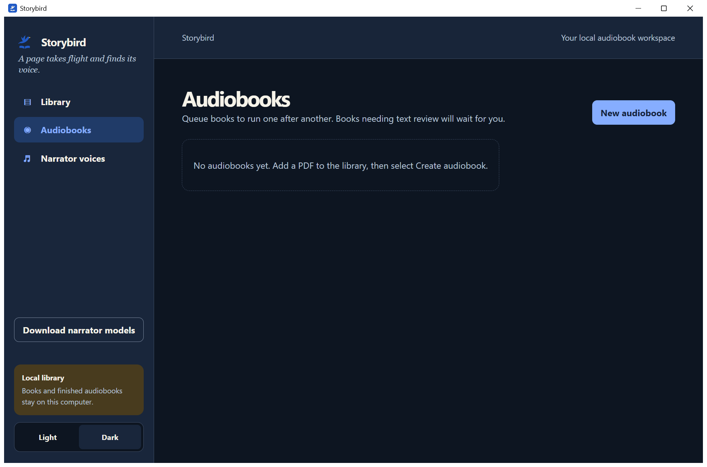

# Storybird

**A local Windows workspace for turning PDFs into chaptered audiobooks, with text and narration review along the way.**

*Actual native-app screenshot from the 1.1.0 candidate, captured in an isolated empty workspace. It contains no private books, voices or jobs. This is a development preview, not evidence that the public app installer has shipped.*

## Release status

**The new Storybird Windows app beta is still being validated. No new public app installer is available yet.** The upcoming beta is scoped to the tested RTX 4090/Ada hardware. Physical 16 GB GPU support remains unverified.

[**Available now: optional Drama runtime-only prerelease**](https://github.com/Lipton1010/Audiobook-Studio/releases/tag/drama-runtime-4e6018f-win64-ada-beta.1)

That separate unsigned Windows x64 ZIP contains **no model weights and is not the Storybird application installer**. It targets NVIDIA Ada compute capability 8.9. Review its component terms, compatibility limits and SHA-256 before use. Do not overwrite a working runtime or assume it supports another GPU architecture.

The published source and earlier private 1.0.7 beta are distinct from the new 1.1.2 candidate described below. Historical [1.0.7 validation](RELEASE_1_0_7.md) does not certify the new installer. Application download links will be added only after exact-build validation and publication.

## The workflow

1. Add a PDF you have the right to use and choose the pages to narrate.
2. Review extracted text, chapter divisions and visual passages before rendering.
3. Choose a supported narrator and a voice reference you are authorized to use.
4. Generate locally, review flagged passages, then export the finished audiobook.

Storybird keeps resumable jobs and existing audio separate from text-review decisions. Books queue sequentially. OCR and speech generation do not run together on the GPU. Completed books have playback, download and export controls; M4B supports chapter navigation when the source and assembly metadata provide it.

No purchased books, voice samples or generated audiobooks are distributed with the application.

## Upcoming 1.1.2 core and optional packs

These changes are in the release candidate, not a claim about older installers:

- **Core-first installation:** private Miniforge-based Python runtime, without downloading any narrator model automatically.
- **Optional narrator picker:** review the model source, terms, download size and local hardware check before downloading a supported pack. Existing jobs and narrator choices are not silently changed.
- **PDF backend migration:** PDFium renders pages and pdfplumber/Pillow support extraction and image handling. The candidate replaces the PyMuPDF dependency. This is distinct from OCR: scanned-page recognition still uses the configured GLM-OCR workflow through Ollama.
- **Native-window prerequisite:** Microsoft WebView2 is required. Existing usable installations are reused; installing a missing runtime requires a separate terms/diagnostics/update disclosure and opt-in. There is no silent browser fallback.

Complex layouts still need review. A successful novel extraction does not establish perfect reading order for every illustrated or multi-column PDF. OCR setup is separate and is not silently installed or changed.

## Narrator and hardware expectations

The candidate checks GPU total/free VRAM, RAM and disk before optional setup and again before generation. Unknown device information is treated as unknown, not as a compatible GPU. Multiple GPUs do not have their memory added together.

- **Drama 3 Q3:** separate experimental portability work, not a validated beta narration path. The standalone runtime smoke used its four-CPU-expert-layer default, not the app's twelve-layer configuration. The app configuration remains unverified. Its 20 GiB VRAM / 22 GiB RAM admission estimates are not measured minimums. Do not interpret the runtime download as proof that this configuration will fit your machine.
- **VibeVoice 1.5B:** supported optional narrator path, with RTX 4090 evidence. Smaller cards are candidates, not validated devices; setup and generation estimates are not guarantees.
- **Chatterbox original English:** explicit optional download with pinned official files and SHA-256 verification, a separate Python runtime, and offline loading. Fresh provisioning and short synthetic speech were tested on RTX 4090. The five model files total 3.19 GB; runtime downloads and unpacking require additional space. A short sample used about 3.2 GiB allocated/reserved CUDA memory, not a universal VRAM minimum. A prior 16 GB laptop trial encountered OOM; 16 GB support is unverified. Upstream retired this research project in August 2026. Upstream implements PerTh watermarking, but Storybird's existing worker uses a no-op watermark adapter: do not assume its output is watermarked. See [component notices](docs/CHATTERBOX_DEPENDENCIES.md).

Drama's speech checker runs separately from generation. Voice/model licensing, context length, other GPU programs and available host RAM all affect usable configurations. The model picker lists the exact pack sources and terms. No model is automatically downloaded merely because it is selected for inspection.

## Privacy and licenses

Application books, jobs and audio are stored locally. Optional downloads contact the displayed upstream providers. Crash reporting is disabled by default; any configured reporting endpoint is an explicit local choice. Microsoft WebView2 has its own diagnostic-data and automatic-update behavior, separate from Storybird's reporting settings.

The owner selected **Apache-2.0 for original application code in the upcoming release**. Do not infer that this relicenses older snapshots, third-party dependencies or model weights. Each component and model keeps its own terms, including any noncommercial or conditional-use restrictions. Only use books, voices and media for which you have the necessary rights.

## Development and validation

The upcoming full installer and patch are built from a clean committed source snapshot using `install\build_installer.bat`. The build audits its manifest to exclude books, audio, voices, jobs and private configuration. The regression suite is `python -m unittest discover -s tests -v`; dependency-specific skips must be reported separately from passes.

The beta patch accepts version **1.1.0 only** and refuses other or missing version markers before copying app files. For older versions, back up books, voices, jobs, audiobooks and configuration before considering the full installer. Older-version upgrades and their data preservation are **unverified**. A failed partial patch must be repaired with the full installer, not reapplied.

Clean-PC WebView2 installation remains **unverified** after Windows Sandbox blocked the Microsoft installer. Testing with an already installed WebView2 runtime is not a fresh-PC certification. The owner approved this explicitly disclosed experimental-beta limitation.

Fresh-install, native-window, upgrade/data-preservation and shutdown checks are tracked separately. An Alpha developer-machine run is not a clean-machine certification. See [the release checklist](RELEASE_CHECKLIST.md) for the repository's published gates; the candidate records the owner's narrower experimental-hardware scope separately until its source is published.

Earlier setup documentation may refer to Miniconda, PyMuPDF or automatic narrator prefetch. Those describe historical builds, not the upcoming core-plus-optional-packs installer. Wait for the new release's verified assets and instructions rather than treating an old private installer as current.
